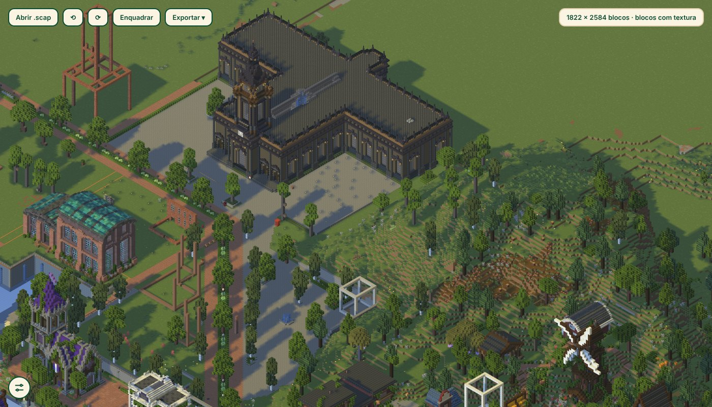
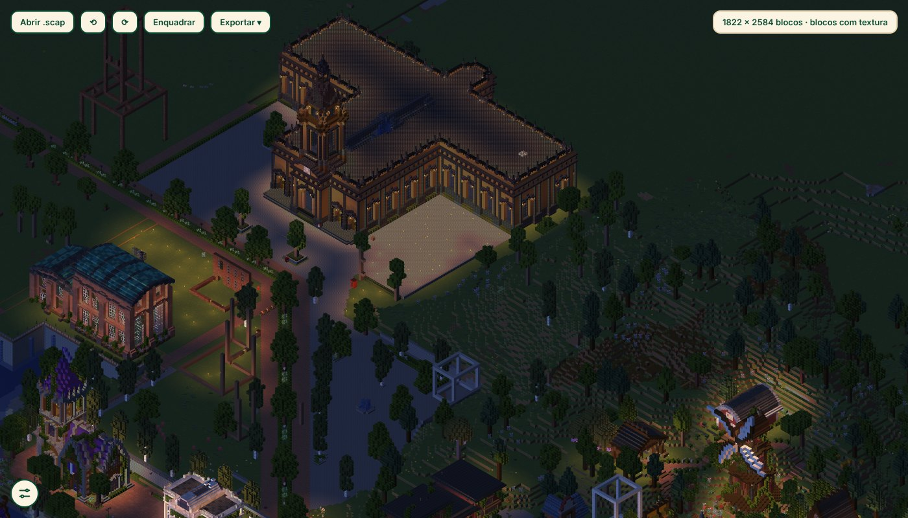
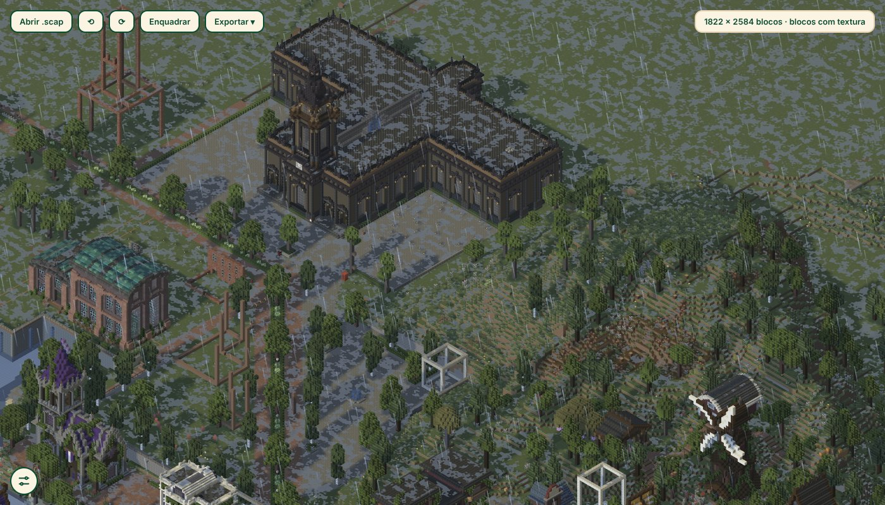
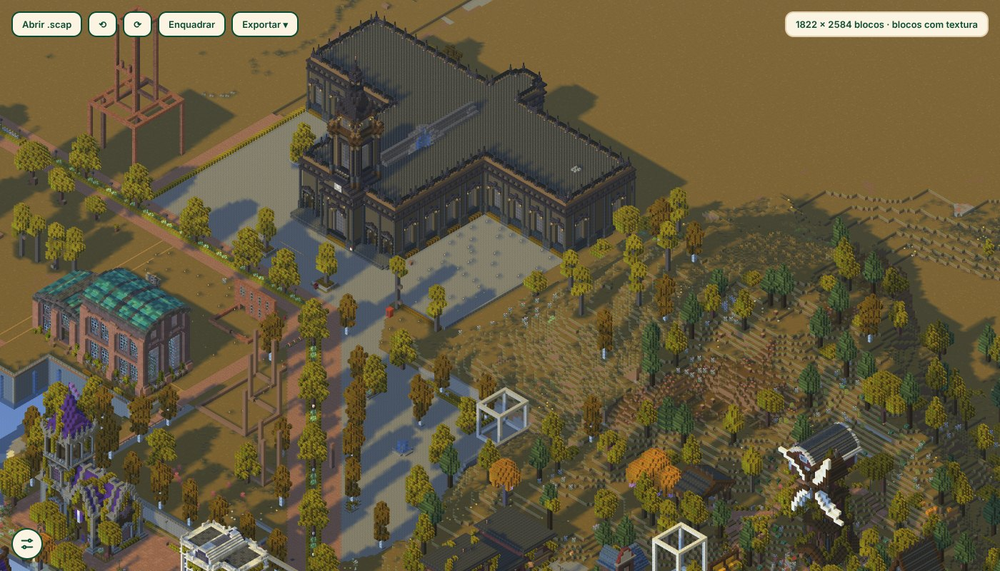
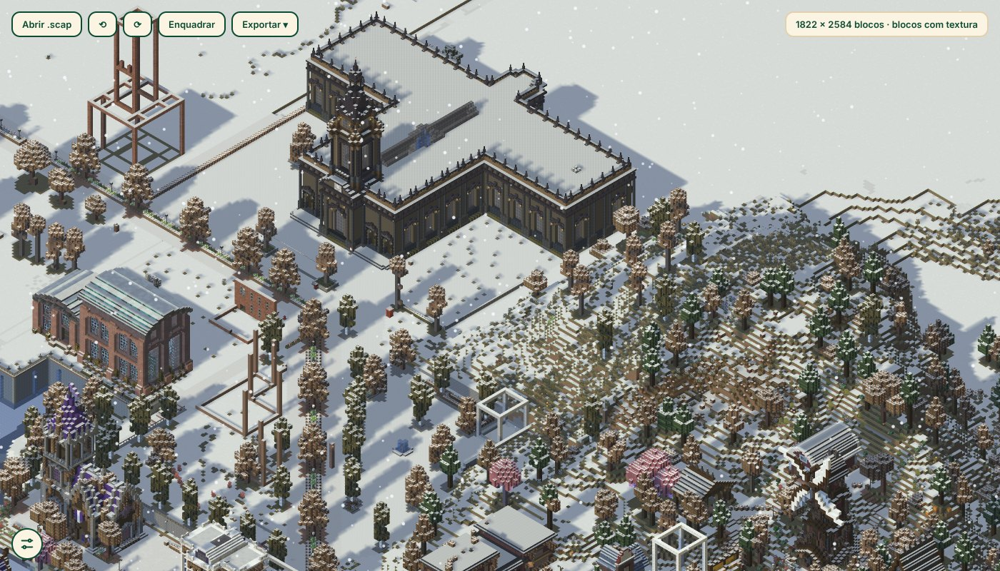

<div align="center">


# Scap

**Escaneie seu mundo de Minecraft e navegue por ele em 3D.**

Um app de Windows que transforma uma área do mundo num arquivo `.scap` de poucos MB
e abre num mapa isométrico, com sombra, noite, chuva, neve e estações do ano.

[Baixar para Windows](../../releases/latest) · [Como usar](#como-usar) · [Licença](#licença)

<br>



</div>

<br>

## O que é

O Scap lê as pastas de um mundo Java (1.18 ou mais novo), junta os modelos e as texturas do jogo, dos mods e dos resource packs, e guarda só os blocos visíveis num arquivo compacto. O visualizador abre esse arquivo direto, sem Minecraft instalado, e dá para exportar o resultado como imagem, vídeo ou uma página HTML única para mandar para alguém.

Foi feito e testado com um mundo Forge 1.20.1 cheio de mods.

## Como fica

<table>
  <tr>
    <td></td>
    <td></td>
  </tr>
  <tr>
    <td align="center">Noite, com luz de tochas e janelas acesas</td>
    <td align="center">Chuva, com chão molhado e poças</td>
  </tr>
  <tr>
    <td></td>
    <td></td>
  </tr>
  <tr>
    <td align="center">Outono</td>
    <td align="center">Inverno, com neve nos topos</td>
  </tr>
</table>

As estações seguem os 24 termos solares do mod Ecliptic Seasons, com as mesmas cores de grama, folhas, bétula e pinheiro.

## O que tem

- Mapa isométrico em 3D, com sombras e texturas animadas
- Sol do meio-dia, nascer, pôr do sol e noite, com brilho das luzes
- Chuva, neve e estações do ano
- Suporte a mods e resource packs, incluindo regras do OptiFine (`random`, `fixed`, `overlay`), Copycats e quadro-negro do Supplementaries
- Exporta imagem PNG, a página HTML, vídeo do ciclo dia e noite e vídeo girando em volta do mapa
- Atualiza sozinho pelo botão da tela Sobre

## Como usar

1. Baixe o `Scap-Setup.exe` em [Releases](../../releases/latest) e instale.
2. Escolha a pasta do mundo (a que tem a pasta `region`). O app tenta achar o jar do Minecraft e a pasta `mods` sozinho.
3. Marque a área no mapa de cima, confira o Y mínimo e máximo e escaneie.
4. O arquivo `.scap` abre no visualizador. Dá para abrir de novo depois pelo botão Abrir.

Quer testar antes? Tem um mapa pronto em [`Scan/exemplo`](Scan/exemplo/cidade_exemplo.scap).

### Pelo terminal

```
python mcscan.py --mundo "C:\mundo" --x1 0 --z1 0 --x2 800 --z2 800 \
                 --ymin 60 --ymax 160 \
                 --jar "C:\...\1.20.1.jar" --mods "C:\...\mods" \
                 --saida cidade.scap
```

### Rodar pelo código

```
cd Scan
pip install -r requirements.txt
python mapscan_gui.py
```

## Limites

- Blocos que o mod desenha por código (baús, camas, placas, banners, cabeças) viram cubos com a textura do bloco. O relatório do scan lista quais.
- Entidades, itens, conteúdo de baús e texto de placas não são guardados.
- A água é um bloco cheio, sem fluxo.
- Em mapas muito grandes, de longe o visualizador mostra pilares simples e só desenha os blocos com textura perto de onde você está olhando.

Os detalhes ficam em [`Scan/LEIA-ME.md`](Scan/LEIA-ME.md).

## Licença

[MIT](LICENSE). Feito por Essie N Pierot.
